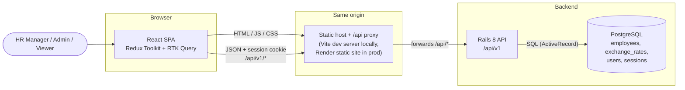
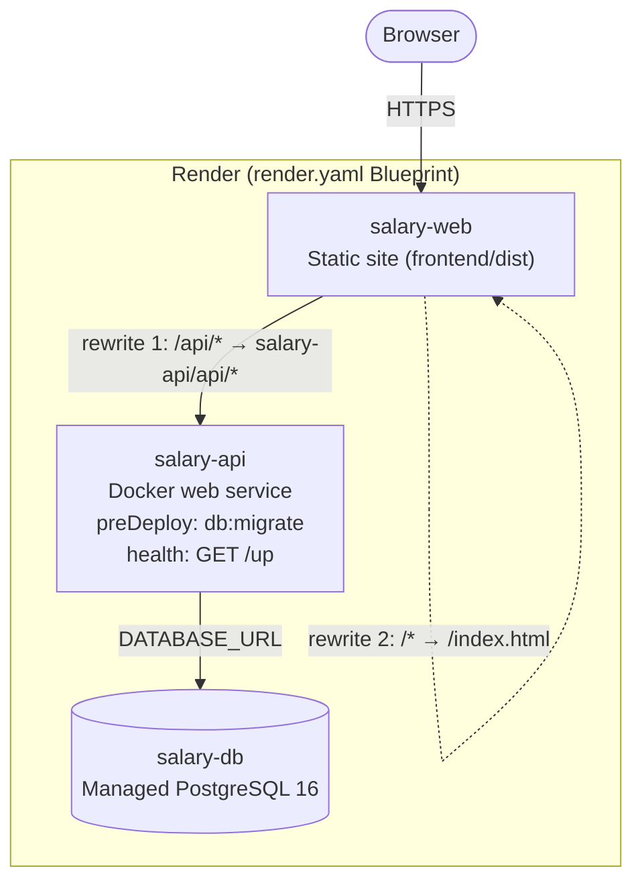
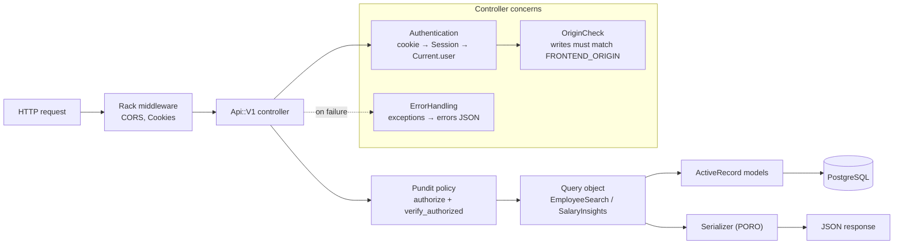
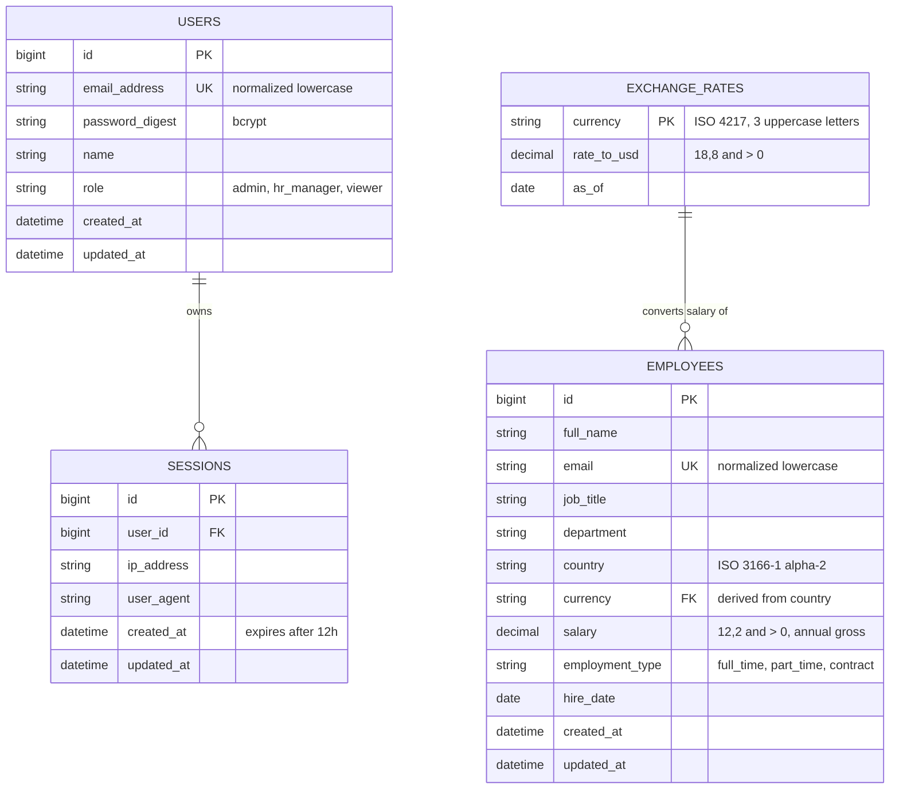
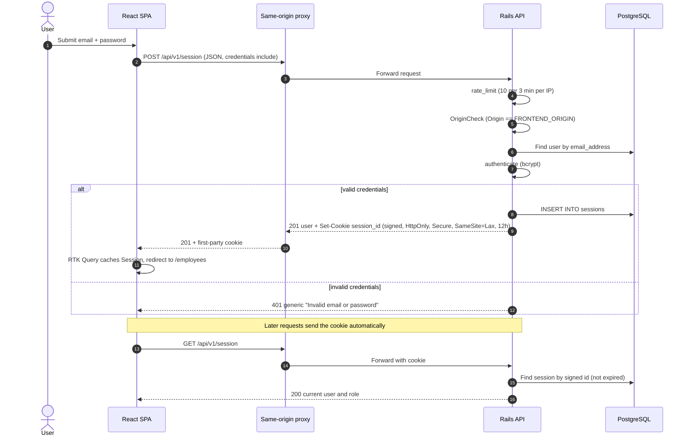
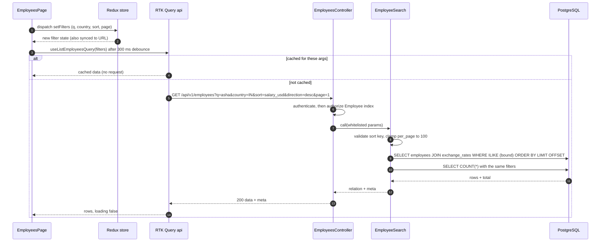
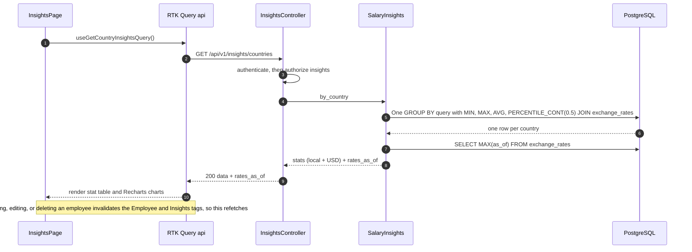
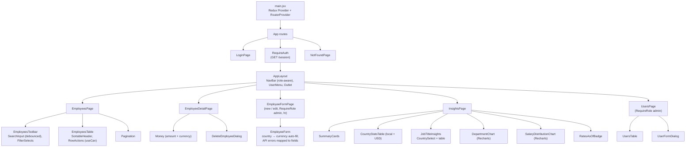
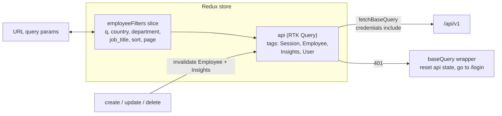

# Architecture — ACME Salary Management

This doc shows how the system fits together, from the whole system down to single requests. The reasoning behind the design is in [DESIGN_NOTES.md](./DESIGN_NOTES.md).

## 1. System Context



The browser only ever talks to **one origin**. That origin serves the React bundle and forwards every `/api/*` request to Rails. So the session cookie is always first-party, and `SameSite=Lax` works both locally and on Render.

Rails does all the business work:
- checks who you are (authentication)
- checks what your role allows (authorization)
- validates input
- computes the salary insights in SQL

## 2. Deployment View (Render)



**Rewrite order matters.** The `/api/*` rule must come before the catch-all SPA fallback. Otherwise API calls would get back `index.html`.

`onrender.com` is a public suffix, so `salary-web` and `salary-api` count as different sites. The rewrite makes them appear as one origin to the browser.

Local development mirrors this layout:
- **Vite dev server:** proxies `/api` to `localhost:3000`.
- **Docker Compose:** runs `db`, `backend`, and `frontend`.

## 3. Backend Request Pipeline



Controllers stay thin. Each one:
1. Authenticates the user.
2. Authorizes the action.
3. Hands the whitelisted params to a query object or model.
4. Serializes the result.

Every failure goes through one `ErrorHandling` concern, so all errors share a single JSON shape:

| Failure | Status |
|---------|--------|
| Validation error | 422 |
| Record not found | 404 |
| Pundit forbidden | 403 |
| Unauthenticated | 401 |
| Bad parameter | 400 |
| Rate limited | 429 |
| Write from a foreign or missing `Origin` | 403 (`invalid_origin`) |
| Write body that isn't JSON | 415 |

## 4. Data Model (ER Diagram)



`employees` has no link to `users`. Users are the people who operate the system; employees are the records being managed.

`employees.currency` is a foreign key to `exchange_rates`. So every salary can be converted to USD with a plain `JOIN`, and a salary can never be stored in a currency that has no rate.

Every column is `NOT NULL` unless stated otherwise. Enums and `salary > 0` are enforced with `CHECK` constraints that mirror the model validations.

## 5. Login & Session Cookie



JavaScript never sees the session ID: the cookie is `HttpOnly`, so an XSS bug can't steal it.

Logging out (`DELETE /session`) deletes the session row, so the cookie stops working immediately, even before it expires.

## 6. Employee List Request



The search string is sent only as a bound parameter. Sort keys are looked up in a fixed map of SQL expressions, and any key outside it returns `400`.

The query uses the trigram GIN indexes for `ILIKE` and the `(country, job_title)` index for filters. It returns one page plus a count, so rows are never loaded just to count them.

## 7. Insights Request



Each insight is **a single SQL statement**. Nothing is aggregated in Ruby. For example:

```sql
SELECT e.country, e.currency, COUNT(*) AS headcount,
       MIN(e.salary) AS min, MAX(e.salary) AS max, AVG(e.salary) AS avg,
       PERCENTILE_CONT(0.5) WITHIN GROUP (ORDER BY e.salary) AS median,
       r.rate_to_usd
FROM employees e
JOIN exchange_rates r ON r.currency = e.currency
GROUP BY e.country, e.currency, r.rate_to_usd
ORDER BY e.country;
```

Each country has exactly one currency, so each USD stat is just the local stat × `rate_to_usd`.

Figures that span countries, like department averages and distribution buckets, work differently: they compute `salary * rate_to_usd` per row inside the aggregate. Buckets are fixed 25,000 USD bands, computed as `FLOOR(salary_usd / 25000)` and grouped in SQL. Empty bands in between are filled with zero, so the histogram has no gaps.

## 8. Frontend Component Tree



Shared building blocks:
- `Money`, `LoadingState`, `EmptyState`, `ErrorState`, `ConfirmDialog`, and `FormField` live in `src/components/`.
- The `useCan(action)` hook reads the current user's role. It hides controls the role can't use; the API still enforces the rules.

## 9. Frontend State



Server data lives only in the RTK Query cache; it's never copied into hand-written slices.

The only client state is the list filters. They're synced to the URL, so a filtered view can be bookmarked or shared.
